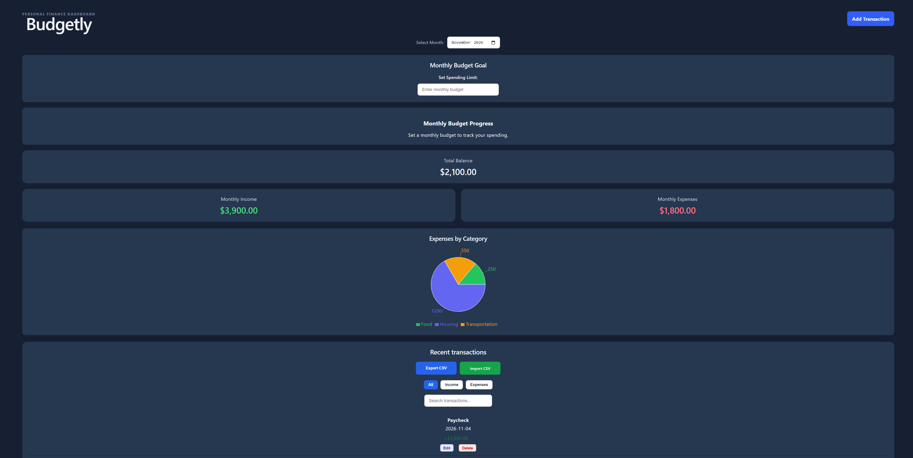
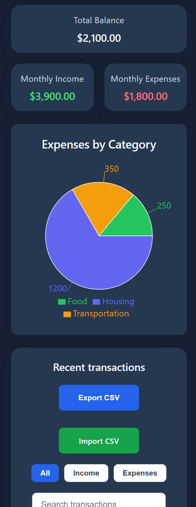

# Budgetly — Personal Finance Dashboard

Budgetly is a responsive personal finance dashboard built with React and TypeScript. Track income and expenses, set monthly budgets, and see where your money goes with interactive charts. No account is needed: your data stays in your browser.

**[Live Demo →](https://budgetly-sage.vercel.app)** (loads with sample data so you can explore right away)

## Screenshots

### Desktop



### Mobile



## Features

- **Transaction management:** add, edit, and delete income and expense transactions.
- **Dashboard overview:** see total balance, income, and expenses at a glance.
- **Spending by category:** an interactive chart shows where your money goes.
- **Search and filters:** find transactions by keyword, and filter by type, category, and month.
- **CSV import and export:** bring in existing records or download your data.
- **Local persistence:** transactions are saved in the browser with `localStorage`.
- **Input validation:** invalid entries are rejected before they are saved.
- **Responsive layout:** designed for both desktop and mobile screens.

## Tech Stack

| Area | Tools |
| --- | --- |
| Framework | React 19, TypeScript |
| Build tool | Vite |
| Charts | Recharts |
| Storage | Browser `localStorage` API |
| Quality | ESLint, TypeScript type-checking on build |
| Hosting | Vercel |

## Getting Started

### Prerequisites

[Node.js](https://nodejs.org/) (current LTS) and npm.

### Run locally

```bash
git clone https://github.com/KevinEm1/Budgetly.git
cd Budgetly
npm install
npm run dev
```

Then open the local URL printed in your terminal.

### Other scripts

| Command | What it does |
| --- | --- |
| `npm run build` | Type-checks the project and creates a production build |
| `npm run preview` | Serves the production build locally |
| `npm run lint` | Runs ESLint |

## Technical Notes

  **Architecture and State Management**

- Built with React, TypeScript, and Vite for a modern, component-based frontend architecture.
- Used React hooks (useState and useEffect) to manage transaction data and synchronize changes with localStorage.
- Defined TypeScript types for transactions to improve type safety and maintainability.

**Data Persistence and Validation**

- Implemented localStorage to preserve transaction data across browser sessions without requiring a backend.
- Added form validation to prevent invalid transaction entries, including empty descriptions, non-positive amounts, and invalid dates.
- Implemented CSV import and export functionality to support transaction data portability.

**Data Visualization**

- Integrated Recharts to visualize expenses by category using an interactive pie chart.
- Implemented category-specific colors and currency-formatted tooltips to improve readability.

**Performance Optimization**

- Implemented code splitting using React.lazy() and Suspense to load the chart component separately from the main application.
- Reduced the initial JavaScript bundle from 563.42 kB to 233.86 kB, approximately a 58.5% reduction.
- Resolved Vite's 500 kB chunk-size warning without increasing the warning threshold.
- Verified that chart functionality remained intact after optimization.

**Deployment**

- Deployed the application using Vercel.
- Used Git and GitHub for version control and deployment updates.


## What I Learned

- Building Budgetly strengthened my understanding of React, TypeScript, and front-end application development.

Key learning experiences included:

- Managing application state with React hooks.
- Using TypeScript interfaces and types to structure transaction data.
- Implementing CRUD operations.
- Persisting data using LocalStorage.
- Handling CSV file imports and exports.
- Creating responsive layouts for different screen sizes.
- Debugging application logic and improving user experience.
- Deploying a production-ready application using Vercel.

## Known Limitations

- Data lives only in your browser. Clearing site data or switching devices means starting over, because there is no account or server.

## Roadmap

- [ ] User accounts with cloud storage (so data syncs across devices)
- [ ] Automated tests for calculations and CSV handling
- [ ] Recurring transactions
- [ ] Spending goals and notifications
- [ ] Monthly and yearly reports

## Author

Built by [Kevin Emiliano](https://github.com/KevinEm1). Connect with me on [LinkedIn](https://www.linkedin.com/in/kevin-emiliano/).
